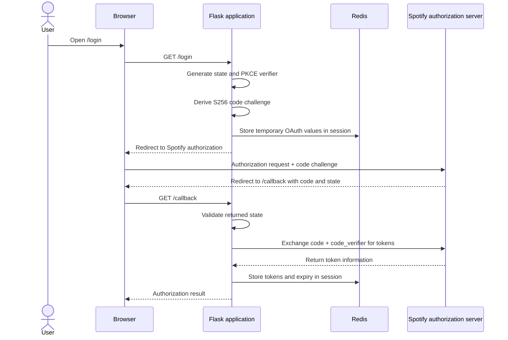
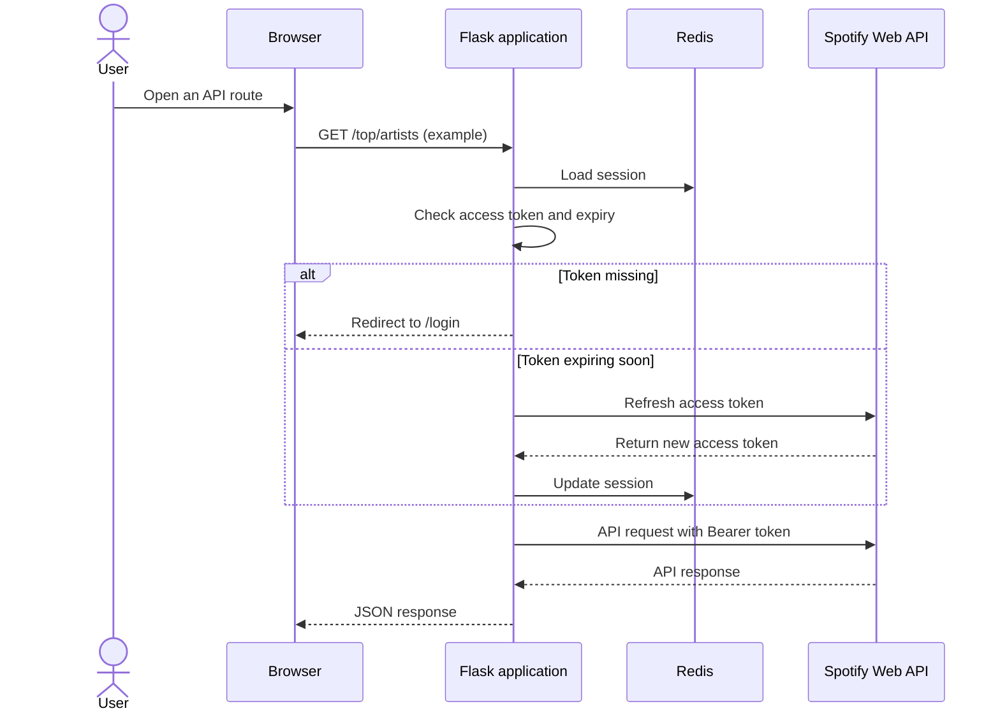

# spotify-api-oauth-security

A learning project exploring OAuth 2.0 Authorization Code Flow with PKCE, server-side session management, token refresh, and secure access to the Spotify Web API using Flask.

The goal is to understand the authentication and API-request pipeline, including the security decisions behind each component.

## Implemented Features

- OAuth 2.0 Authorization Code Flow with PKCE (`S256`)
- Random OAuth `state` generation and callback validation
- Authorization-code exchange with Spotify
- Redis-backed server-side sessions using Flask-Session
- Server-side storage of access tokens, refresh tokens, and access-token expiry
- Access-token refresh before expiry
- A shared Spotify API-request helper
- Routes for the current user's profile, top artists, and top tracks
- Automated tests using `pytest`, Flask's test client, and mocks

## Tech Stack

- **Python** — application logic
- **Flask** — web application and routes
- **Spotify Web API** — authorization and music data
- **OAuth 2.0 with PKCE** — authorization flow
- **Redis** — server-side session storage
- **Flask-Session** — server-side Flask sessions
- **python-dotenv** — local environment variables
- **Requests** — HTTP requests to Spotify
- **pytest** — automated tests

## Architecture

### 1. Authorization flow



### 2. Authenticated API request



The diagrams describe the current flow at a high level. Unexpected `401` retry behavior and rate-limit handling are still planned.

## OAuth and PKCE

The application uses the Authorization Code Flow with Proof Key for Code Exchange (PKCE).

PKCE helps protect an authorization code from being used by someone who intercepts it. The application generates a temporary secret called the `code_verifier` and proves possession of it during the token exchange.

- `code_verifier`: a random secret retained in the server-side session.
- `code_challenge`: the Base64URL-encoded SHA-256 hash of the verifier, with trailing padding removed.
- `code_challenge_method=S256`: tells Spotify how the challenge was generated.
- `state`: a separate random value used to associate the callback with the login attempt and protect against login CSRF.

Conceptually:

```text
code_challenge = BASE64URL(SHA256(code_verifier))
```

The `state` value and PKCE verifier serve different purposes. PKCE does not replace callback `state` validation.

## Session and Token Management

Flask's default session implementation stores session data in a signed cookie. Signing protects integrity, but it does not encrypt the cookie contents.

This project uses Flask-Session with Redis to keep session data on the server. The browser carries a session identifier, while the corresponding session data is stored in Redis.

The application stores the access token, its expiry time, and the refresh token in the server-side session. Before making a Spotify API request, the shared helper checks whether the access token is missing or is close to expiry. If it is close to expiry, the helper attempts to refresh it.

The shared helper centralizes session checks, token-expiry handling, and the authenticated HTTP request so individual routes do not each implement those steps.

## Routes

| Route | Purpose |
|---|---|
| `/login` | Starts Spotify authorization with `state` and a PKCE challenge |
| `/callback` | Validates the callback and exchanges the authorization code for tokens |
| `/me` | Fetches the current user's Spotify profile |
| `/top/artists` | Fetches the current user's top artists |
| `/top/tracks` | Fetches the current user's top tracks |

The top-artists and top-tracks routes request 10 items with `time_range=medium_term`. Spotify's `medium_term` is a medium-term ranking window, not a month-by-month listening history.

The app requests the `user-top-read` and `user-read-recently-played` scopes. The recently-played scope is configured, but a `/recently-played` route is not yet implemented.

## Automated Tests

Tests live in `test_app.py` and can be run without starting the Flask development server. Route tests use Flask's test client, and mocked responses keep the tests independent of Spotify's live API and the user's listening history.

The current tests cover:

- A successful `/top/artists` response and the JSON fields returned by the route
- Redirecting to `/login` when the request is unauthenticated
- Handling an unsuccessful Spotify API response (simulated `403`)
- The API helper returning `not_authenticated` when no access token exists
- The API helper attempting token refresh when the access token has expired

The token-expiry test mocks the refresh function and Spotify HTTP request. It verifies that the refresh path is invoked; it does not test a real refresh against Spotify.

Run the tests from the project root with the virtual environment activated:

```bash
pytest -v
```

These tests cover selected behavior; they do not prove that every OAuth edge case or production security concern is handled.

## Local Setup

### 1. Clone the repository

```bash
git clone <your-repository-url>
cd spotify-api-oauth-security
```

### 2. Create and activate a virtual environment

```bash
python3 -m venv .venv
source .venv/bin/activate
```

### 3. Install dependencies

```bash
pip install -r requirements.txt
```

If `pytest` is not included in your development dependencies, install it separately:

```bash
pip install pytest
```

### 4. Configure environment variables

Create a local `.env` file in the project root:

```env
SPOTIFY_CLIENT_ID=your_spotify_client_id
FLASK_SECRET_KEY=your_random_flask_secret_key
```

Do not commit `.env` or expose credentials in source code. The Flask secret key should remain stable between application restarts. Exclude `.env` in `.gitignore`.

### 5. Configure the Spotify app

In the Spotify Developer Dashboard, register this exact redirect URI:

```text
http://127.0.0.1:5000/callback
```

The redirect URI in the authorization request, token exchange, and developer dashboard must match exactly.

### 6. Start Redis

Ensure a Redis server is running at `127.0.0.1:6379`, matching the application's session configuration.

The Python Redis package is a client library; it does not start the Redis server.

### 7. Run the application

```bash
python app.py
```

Open `http://127.0.0.1:5000/login` and complete Spotify authorization. After logging in, visit `/me`, `/top/artists`, or `/top/tracks`.

The development server currently runs with Flask debug mode enabled. Use that only for local development, not production deployment.

## Security Considerations

- Generate OAuth `state` and PKCE verifiers using a cryptographically secure random generator.
- Validate `state` before exchanging the authorization code.
- Keep the PKCE verifier and tokens in server-side session storage.
- Never commit `.env`, access tokens, refresh tokens, or other secrets.
- Use the exact registered redirect URI.
- Avoid logging sensitive token values.
- Do not confuse OAuth callback `state` validation with CSRF protection for application forms and POST requests.
- Handle authorization failures and token errors explicitly.
- Use HTTPS and appropriately configured secure session cookies in production.
- Treat this as an educational project, not a production-ready authentication service.

## Planned Work

- Add automated tests for more callback and helper error paths
- Test the refresh function's success and failure handling in isolation
- Retry a Spotify API request once after an unexpected `401`, where appropriate
- Handle Spotify rate-limit responses (`429`) using `Retry-After`
- Add the recently-played endpoint
- Add playlist creation and track addition
- Add CSRF protection for application state-changing POST routes
- Improve setup documentation and review the final security model

## Learning Resources

- [Spotify Authorization Documentation](https://developer.spotify.com/documentation/web-api/concepts/authorization)
- [Spotify Authorization Code with PKCE Tutorial](https://developer.spotify.com/documentation/web-api/tutorials/code-pkce-flow)
- [Spotify Scopes](https://developer.spotify.com/documentation/web-api/concepts/scopes)
- [Spotify Token Refreshing](https://developer.spotify.com/documentation/web-api/tutorials/refreshing-tokens)
- [OAuth 2.0 Security Best Current Practice — RFC 9700](https://www.rfc-editor.org/rfc/rfc9700)

## Current Status

The login and callback flow is implemented, including `state` validation, PKCE token exchange, and Redis-backed server-side token storage. The application can fetch the current user's profile, top artists, and top tracks. The shared API helper checks authentication and token expiry and attempts refresh when the access token is close to expiry.

Automated tests cover selected successful and error paths, including a mocked token-expiry scenario. Unexpected `401` retry behavior, rate-limit handling, playlist operations, broader CSRF protection, and additional test coverage remain future work.

This project is intended to build an understanding of OAuth and application security through implementation and testing, rather than to serve as a production-ready authentication service.
